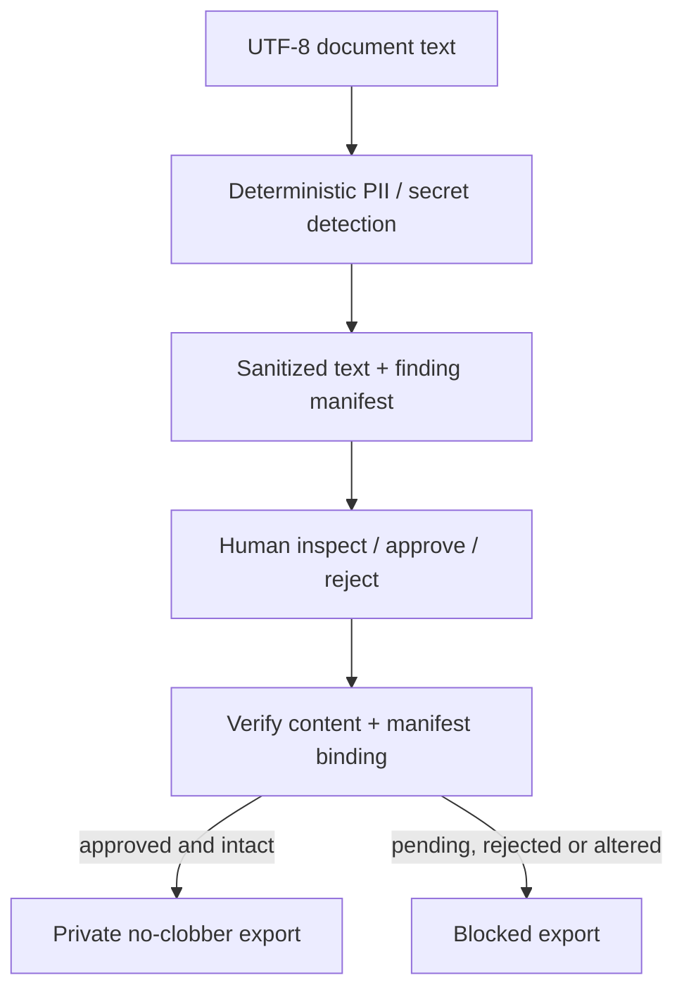

# Document Review Pipeline

[](https://github.com/koushikchowdary6/document-review-pipeline/actions/workflows/ci.yml)

**An offline privacy workflow that redacts structured sensitive data, requires a
manual decision, and blocks export when the reviewed content or manifest changes.**
It combines deterministic detection, review evidence, integrity checks and an
honest synthetic evaluation—not an ML model or LLM-powered detector.

## Quickstart: Run in 5 Minutes

Python **3.10+**, no runtime dependencies:

```bash
git clone https://github.com/koushikchowdary6/document-review-pipeline.git
cd document-review-pipeline
python demo.py
```

The walkthrough prints a **synthetic** document, finding types/offsets, and its
sanitized output. Inspect that output, then type `approve` or `reject`. Approval
exports sanitized text, and the demo deliberately alters the bundle to prove that
subsequent export is blocked. It also checks rejected and unapproved states.

The default `demo-data/` must not exist. For a repeatable non-interactive CI run:

```bash
python demo.py --scripted --output demo-ci
```

`--scripted` records an explicitly **simulated synthetic reviewer**, not a real human
approval. It always uses the included fixture; do not use it to approve real records.
Expected control results:

```json
{"pending_export_blocked":true,"approved_export_succeeded":true,"tampered_export_blocked":true,"rejected_export_blocked":true}
```

The successful export is saved before tampering; already exported files cannot be
revoked by this local tool. Choose a fresh output directory for another walkthrough.

## Architecture



## Explicit review workflow

```bash
python review.py examples/synthetic.txt /tmp/review-bundle
python decision.py inspect /tmp/review-bundle
python decision.py inspect /tmp/review-bundle --show-text
python decision.py decide /tmp/review-bundle --status approved --reviewer "local reviewer" --rationale "Inspected synthetic redacted text"
python decision.py status /tmp/review-bundle
python decision.py export /tmp/review-bundle /tmp/approved-sanitized.txt
```

Choose unused bundle/export paths. Replace `approved` with `rejected` to block release.
`inspect` omits document content by default; `--show-text` is an explicit request to
print sanitized text, which may still contain identifiers the detector missed.
Findings carry **original-text character offsets**, not redacted-output offsets.

Sample input:

```text
Contact: demo@example.com
SSN: 123-45-6789
```

Sanitized output:

```text
Contact: [REDACTED:EMAIL]
SSN: [REDACTED:SSN]
```

The manifest records finding kinds, counts, offsets and content hashes, without raw
matched values or source filenames. Decisions bind both the sanitized text and the
canonical full manifest. Reformatting JSON is harmless; changing source fingerprints,
finding metadata or sanitized content invalidates approval. Legacy unbound decisions
fail closed: generate and review a fresh bundle.

## Measured detection quality

```bash
python evaluate.py
python evaluate.py --output /tmp/new-pii-report.json
```

The [26-case synthetic dataset](fixtures/pii_eval.json) is manually annotated and
includes structured PII, benign negatives, unsupported names/addresses, and boundary
cases. The [checked-in report](evaluation/baseline.json) is generated by the actual
bundled detector and includes dataset/detector fingerprints and per-case errors.
There is no training split because no model is trained.

| Exact kind + span metric | Observed result |
|---|---:|
| True-positive entities | 15 |
| False-positive predicted spans | 2 |
| False-negative annotated spans | 5 |
| Micro precision | 88.24% (15 / 17) |
| Micro recall | 75.00% (15 / 20) |
| Benign documents flagged | 0 / 8 |

These are **small synthetic diagnostics**, not real-world PII accuracy. Strict exact
span scoring counts two phone boundary mismatches as both false positives and false
negatives, even though their numeric portions are masked. A spaced SSN, a contextual
name and a contextual address are missed. A zero-finding document still requires
review. Zero flagged negatives in eight examples is not proof of a zero false-positive
rate in deployment. Unsupported entity types remain in the denominator so recall
limitations are visible. Metrics without an eligible denominator are `null`.

Reports never contain matched values or full document text. Output files are created
exclusively rather than overwriting an older report. No external API is called.

## Security controls and engineering challenges

The difficult part is ensuring that “approved” refers to **the exact evidence that
was inspected**, while not creating a new leak in reports or logs. The export path
uses one validated bundle snapshot and compares it with a manifest-bound decision.
It refuses pending, rejected, modified and malformed evidence.

- Duplicate-key and nonfinite JSON rejection, digest/metadata validation, bounded
  8 MB bundle-entry reads, and regular-file/no-symlink reads where `O_NOFOLLOW` exists.
- Original source text is capped at 1,000,000 characters. Oversized sanitized output
  is rejected before publication; no partial result is forwarded.
- Decisions and exports use private same-directory staging, fsync, and atomic
  no-clobber hard-link publication. Existing paths are never overwritten; failed
  publication leaves no partial destination. Unsupported filesystems fail closed.
- Review bundles are private directories on POSIX. Error messages do not echo input.
  Hashes identify content; they do not encrypt data or prevent guessing.

## Tests and CI

```bash
python -m pip install -r requirements-dev.txt
python -m pytest -q
```

**285 tests passed locally** for this feature: upstream detection regressions plus
review states, altered text/metadata, legacy decisions, malformed timestamps,
symlink/budget rejection, one-snapshot export, publication failures, hand-calculated
metric cases, report reproducibility, and the synthetic end-to-end demo.
[GitHub Actions](https://github.com/koushikchowdary6/document-review-pipeline/actions/workflows/ci.yml)
runs on Python 3.10 and 3.12. The badge reflects main, not an unmerged feature branch.

## Decisions, tradeoffs and limitations

Deterministic patterns and entropy heuristics make processing explainable and offline.
They miss contextual identifiers and unfamiliar formats; human review is a required
control, not a claim of complete de-identification. This tool processes UTF-8 text,
not OCR, PDFs, images or pixel redaction. It does not certify compliance.

Review identity is local **self-attestation**. An attacker with filesystem write access
can forge or replace all evidence or bypass this CLI. Hash binding is not a signature,
tamper-proof audit log or authenticated approval service. The workflow assumes a
trusted, single-writer local workspace; it does not prevent hostile concurrent edits
to the entire bundle directory. POSIX private permissions and filesystem hard links
are used; Windows behavior is not covered by CI. No encrypted storage, key management,
access-controlled review service or downstream document recall is implemented.

## How I'd explain this in an interview

“I built a privacy boundary before document indexing: detect and redact locally,
inspect the findings, approve the exact evidence, and export only when its hashes
still match. I measured the deterministic detector on labeled synthetic examples
and kept the misses visible. The integrity controls and evaluation are the project;
I don't claim an ML detector or compliance certification.”

## Provenance

[PROVENANCE.md](PROVENANCE.md) records the upstream redactor and migration.
Existing copyright/license notices and AI-assisted development provenance are retained.
